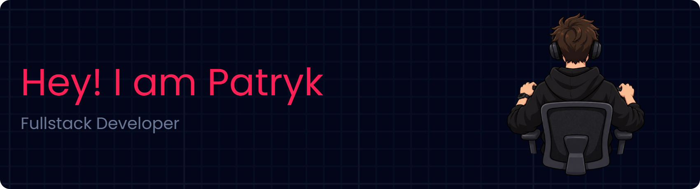

## 🔧 Languages and Tools

## 🧐 About Me

- 🧑🏻 I'm a 20 year old **aspiring junior Frontend developer** passionate about **NextJS, React and TypeScript**
- 🧠 I'm currently learning **new programming language**
- 📌 I live in **Poland, Katowice, Żory**
- 🎯 My goal is to **become a skilled developer** building beautiful and functional web apps
- 🎓 I'm a **high school graduate**
- 📩 Contact me on E-mail: `patryk.jastrzebowski.dev@gmail.com`

## 🕒 In my free time, I like to

- 💻 write code
- 📚 read books about self-improvement
- 🔍 looking inspiration for new projects
- 💬 improve my English
- 🖐🏻 improve my typing speed
- 🏀 enjoy sports ( basketball )
